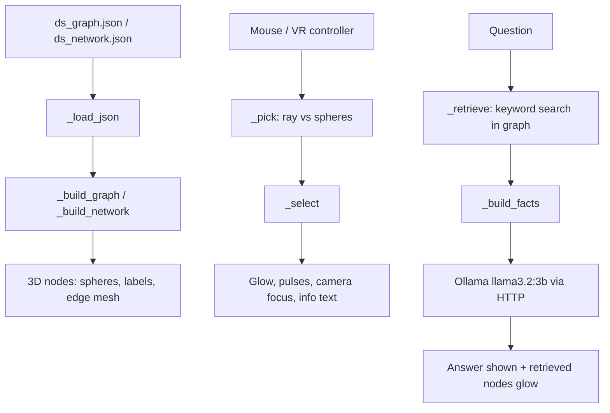

# NeuroGraph XR - Project Documentation

## 1. One-sentence summary
NeuroGraph XR is an interactive 3D / VR application (built in Godot 4.7) that lets you **see and explore** a data science knowledge graph and a neural network, and **ask a local AI questions** whose answers are grounded in that graph (GraphRAG).

## 2. Purpose - why we built it
| Question | Answer |
|---|---|
| What problem does it solve? | Data science concepts (pipelines, models, networks) are abstract and usually shown as flat diagrams. In 3D/VR you can walk around them, pull them apart and inspect them. |
| Why a knowledge graph? | It stores *entities and relations* (e.g. "Gradient Boosting - risks - Overfitting"). It is structured, explainable knowledge. |
| Why a local LLM? | A plain LLM can hallucinate. We first **retrieve the relevant facts from the graph** and tell the LLM to answer only from them. This is **GraphRAG**. It also runs fully offline on a personal laptop (privacy, no API cost, no company model needed). |
| Why XR? | Spatial exploration (rotate, explode, select by pointing) makes structure easier to understand and makes a strong thesis demo. |
| History | The project began as an aircraft-device VR demo using company data/model. That was removed (licence/IP, not usable on a personal laptop) and replaced with a self-created data-science content set. |

## 3. Project structure
```
ds_main.tscn            Main scene: one Node3D with the script attached
scripts/ds_viewer.gd    ALL application logic (class DSViewer)
data/ds_graph.json      Knowledge graph: nodes, categories, edges
data/ds_network.json    Neural network: layers (units, colour, shape, params, description)
assets/generated/audio  Background music + sound effects
addons/godot-xr-tools   Third-party XR helper library (autoloads)
addons/godotopenxrvendors  OpenXR vendor plugin (headset support)
```
Everything visible is **created in code at runtime** from the JSON files. There is no 3D model file: nodes are spheres, edges are lines. To change content, edit the JSON - no code changes needed.

## 4. Architecture overview


## 5. Code walkthrough (`scripts/ds_viewer.gd`)

### 5.1 Startup - `_ready()`
Loads both JSON files, creates the environment (`_setup_environment`), a content root node, camera, HTTP client, UI (`_setup_ui`), audio (`_setup_audio`), tries to start VR (`_setup_xr`), then builds the graph mode.

### 5.2 Environment & look - `_setup_environment`, `_make_stars`
- Dark background colour, filmic tone-mapping and **glow** (bloom) so emissive nodes shine.
- 600 stars drawn with one `MultiMesh` (a single draw call - cheap).
- Glow is switched off in VR for speed.

### 5.3 Knowledge graph - `_build_graph`, `_layout`
- Each JSON node becomes a `MeshInstance3D` sphere. **Size = number of connections** (degree), **colour = category**.
- `g_adj` is an adjacency list (id -> list of neighbours + relation) used for info text and highlighting.
- **Layout (`_layout`)** is a *force-directed* algorithm (Fruchterman-Reingold):
  - every pair of nodes **repels** (force k²/d),
  - every edge **attracts** its two nodes (force d²/k),
  - a small pull towards the centre keeps the graph compact,
  - a "temperature" shrinks each iteration so it settles (250 iterations).
  - Result: related concepts end up near each other. The seed is fixed, so the layout is the same every run.
- Edges are drawn with one `ImmediateMesh` of lines with per-vertex colour (gradient from one node's colour to the other).

### 5.4 Neural network - `_build_network`
- Each layer = a `Node3D` pivot holding a grid of small neuron spheres (`units` from JSON), a coloured material and a label (name + tensor shape).
- Connections: each neuron links to 3 random neurons in the next layer (sparse, so it stays readable).
- **Explode (E)**: `_apply_spread` increases the x-spacing between layers using a smoothstep ease (`spread * spread * (3 - 2 * spread)`).
- **Forward pass (F)**: `_animate_items` moves a "head" along the layers; each layer brightens as the head passes - a visual of data flowing input -> output.

### 5.5 Interaction
- **Picking (`_pick`)**: ray-sphere intersection done by hand. From the mouse (`camera.project_ray_origin/normal`) or the VR controller's forward direction. The nearest hit wins. No physics bodies needed.
- **Hover**: on mouse motion, `_pick` runs and the hovered node glows and scales up.
- **Select (`_select`)**: node pulses, neighbours glow, connected edges brighten, labels appear, camera glides to it, info panel updates, select sound plays.
- **Data packets (`_rebuild_pulses`)**: small glowing dots travel along edges connected to the selection or retrieved nodes.
- **Category filter**: right panel; non-matching nodes and edges are dimmed.
- **Camera (`_update_camera`)**: orbit camera defined by yaw, pitch, distance; values are smoothed with exponential easing (`1 - exp(-delta * k)`, frame-rate independent). Dragging stops auto-rotate.

### 5.6 The AI - GraphRAG
1. `_retrieve(question)`: lowercases the question, removes stop words, scores every node (label match = 3 points, description match = 1 point), keeps the top 4, adds the selected node, and adds the neighbours of the best match (max 8 nodes).
2. `_build_facts`: turns those nodes and the relations between them into text lines. The retrieved nodes are stored in `highlighted`, so they **glow in 3D** - the user sees *what the AI looked at*.
3. `_ask`: builds a prompt: *"Answer in at most 4 sentences using ONLY the facts below..."* + facts + question, and POSTs JSON to Ollama (`http://127.0.0.1:11434/api/generate`, model `llama3.2:3b`, `stream: false`) with `HTTPRequest`.
4. `_on_ai_done`: parses the `response` field. If Ollama is not running, it shows the retrieved facts instead (graceful fallback).

Why keyword retrieval and not embeddings? It is simple, fast and transparent for a small graph. A natural extension is replacing `_retrieve` with embedding similarity (e.g. `nomic-embed-text` in Ollama) plus multi-hop graph traversal.

### 5.7 VR support - `_setup_xr`
- Finds the OpenXR interface; if it initialises, sets `viewport.use_xr = true`, creates `XROrigin3D`, `XRCamera3D`, two `XRController3D` (trackers `left_hand` / `right_hand`), a cyan aim ray, and a floating `Label3D` for info text.
- The content is scaled to 0.11 and placed 1.6 m in front of the user at 1.3 m height.
- Buttons: right trigger select, A explode, B switch mode, left X explain, left Y reset; left stick rotates, right stick scales.
- If no headset is found it silently falls back to desktop mode.
- **Status: written but not yet tested on a headset.**

### 5.8 Audio - `_setup_audio`
Looping ambient music (`AudioStreamMP3.loop = true`, -14 dB, toggle with M) and two sound effects (select blip, explode whoosh) played through short-lived `AudioStreamPlayer` nodes that free themselves when finished.

## 6. Controls
| Action | Desktop | VR |
|---|---|---|
| Graph / Network mode | 1 / 2 | B |
| Select | click | right trigger |
| Hover preview | mouse over | - |
| Explode / assemble | E | A |
| Forward pass (network) | F | - |
| Reset | R | left Y |
| Auto-spin | T | - |
| Music | M | - |
| Orbit / zoom | drag / wheel | left stick rotate, right stick scale |
| Ask AI | type + Enter, or click a suggested question | left X (explain selection) |

## 7. Data formats
`ds_graph.json`
```json
{ "categories": {"Model": "#ff8a3d"},
  "nodes": [{"id":"xgboost","label":"Gradient Boosting","category":"Model","desc":"..."}],
  "edges": [["dataset","xgboost","trains"]] }   // [from, to, relation]
```
`ds_network.json`
```json
{ "layers": [{"name":"LSTM","units":20,"color":"#b583ff","shape":"[batch, 64]","params":33024,"desc":"..."}] }
```

## 8. Setup
1. Godot 4.7 (the project is GDScript only).
2. Install Ollama (`irm https://ollama.com/install.ps1 | iex` in PowerShell), then `ollama pull llama3.2:3b`.
3. Open the project, press F5. Without a headset it runs in desktop mode.

## 9. Design decisions - likely questions & answers
- **Why generate everything in code?** No dependency on 3D assets or licences; content is data-driven (edit JSON) and the same code works for any graph.
- **Why GraphRAG instead of plain chat?** Grounding reduces hallucination and the answer is traceable to specific nodes, which are visualised.
- **Why a local model?** Privacy, free, works offline, no company API needed. Trade-off: a 3B model is less capable than large cloud models.
- **Why manual ray-sphere picking?** Simple, fast, and avoids creating collision bodies for ~35 objects.
- **Why force-directed layout?** It automatically places related concepts close together, so the geometry itself carries meaning.
- **Performance?** One MultiMesh for stars, one ImmediateMesh for all edges, glow disabled in VR, small node counts.

## 10. Limitations & future work
- VR input is untested on hardware; button names may need adjusting.
- Retrieval is keyword-based; no embeddings or multi-hop reasoning yet.
- Graph content is hand-written. Future: auto-extract triples from papers/notes with an LLM, import a real Neo4j/NetworkX graph.
- Possible new modes: 3D embedding scatter plot (t-SNE/UMAP), live training visualisation, real dataset exploration.
- Edges are 1-pixel lines (thin in VR); could use cylinders or a line shader.
- Voice input / spoken answers (text-to-speech) could be added.

## 11. Short pitch you can say aloud
"NeuroGraph XR turns abstract data science knowledge into a 3D space you can explore. A force-directed algorithm lays out a knowledge graph so related ideas sit close together. When you ask a question, the system retrieves the relevant nodes from the graph, sends only those facts to a local LLM, and highlights them in 3D, so the answer is grounded and explainable. A second mode visualises a neural network layer by layer with an explode view and a forward-pass animation. Everything runs locally on a laptop and works on desktop or in VR."
