<div align="center">

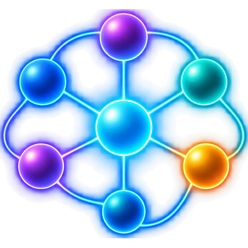

# NeuroGraph XR

### Learn how AI works — by walking through it in 3D and VR

*Knowledge graphs you can fly through · a neural network you can pull apart · an AI tutor you can talk to*

[](https://godotengine.org)
[](https://www.khronos.org/openxr/)
[](https://ollama.com)
[](https://github.com/SYSTRAN/faster-whisper)
[](#-how-the-ai-tutor-works-graphrag)
[](LICENSE)

<br/>

<a href="https://ayush009.github.io/NeuroGraph-XR/"></a>
&nbsp;
<a href="https://github.com/ayush009/NeuroGraph-XR/releases/latest/download/NeuroGraph_XR_Windows.zip"></a>

<sub>The browser demo has the 3D graph, the **full AI Engineering course**, guided tour, quiz and all labs. The Windows app adds VR, the local AI tutor and voice questions.</sub>

<br/><br/>

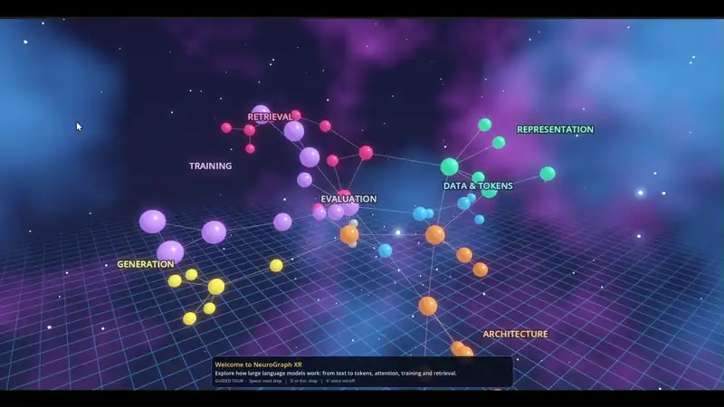

**[🎬 Watch the full demo](docs/media/demo.mp4)** &nbsp;·&nbsp; **[✨ Features](#-features)** &nbsp;·&nbsp; **[🚀 Quick start](#-quick-start)** &nbsp;·&nbsp; **[🥽 VR controls](#-vr-controls)** &nbsp;·&nbsp; **[🧠 How it works](#-how-the-ai-tutor-works-graphrag)**

</div>

<!-- To get an inline video player here: edit this file on github.com and drag docs/media/demo.mp4 (or Video/NeuroGraph_XR_web.mp4) onto this line. -->

---

## 💡 Why NeuroGraph XR?

AI concepts — tokens, embeddings, attention, RAG — are usually taught as flat diagrams and walls of text.
**NeuroGraph XR turns them into a world you can explore.** Every concept is a glowing node, every relation a line,
and a narrated tour, a quiz and hands-on labs guide you through it. Stuck? **Just ask out loud** — a local AI
answers from the knowledge graph and speaks the answer back. No cloud, no API keys, no data leaves your PC.

<table>
<tr>
<td align="center" width="25%">🌌<br/><b>Explore in 3D / VR</b><br/><sub>Fly around 88 connected concepts, on a monitor or in a headset</sub></td>
<td align="center" width="25%">🎙️<br/><b>Talk to your tutor</b><br/><sub>Hold a button, ask a question, hear the answer</sub></td>
<td align="center" width="25%">🧪<br/><b>Learn by doing</b><br/><sub>Token, Attention and Sampling labs with real maths</sub></td>
<td align="center" width="25%">🔒<br/><b>Fully local</b><br/><sub>Llama 3.2 via Ollama + Whisper speech, all on your machine</sub></td>
</tr>
</table>

---

## ✨ Features

<table>
<tr>
<td width="50%">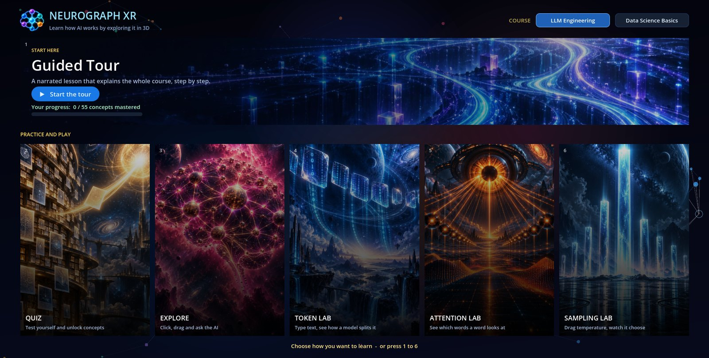</td>
<td width="50%">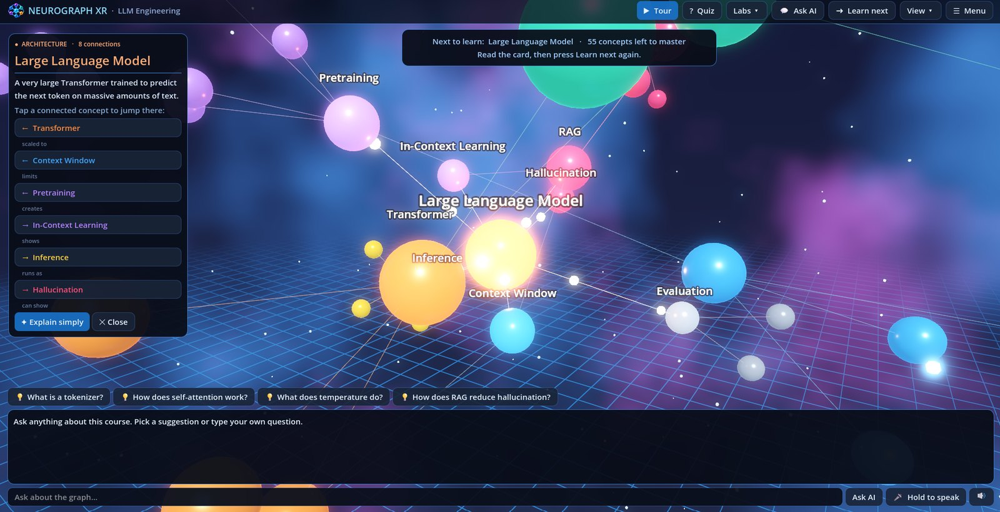</td>
</tr>
<tr>
<td><b>🏠 Home menu & two courses</b><br/>Pick <i>LLM Engineering</i> (55 concepts) or <i>Data Science Basics</i> (33 concepts). Your progress is saved — mastered concepts turn gold.</td>
<td><b>🔎 Explore the knowledge graph</b><br/>Click any concept for a plain-language card and jump along its connections. <i>Learn next</i> walks you through the course in teaching order.</td>
</tr>
<tr>
<td>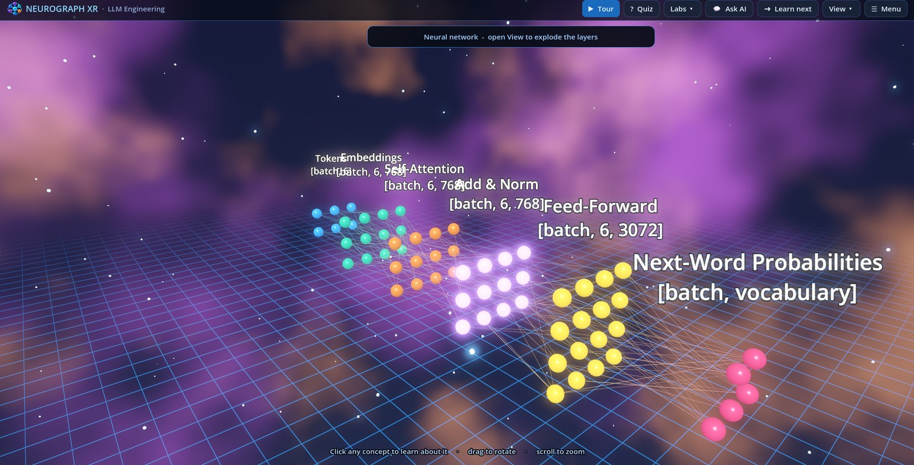</td>
<td>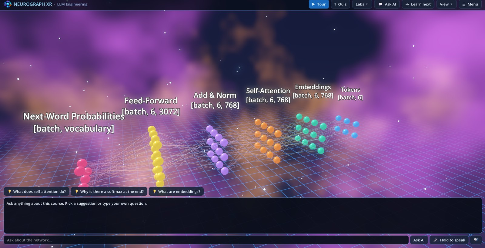</td>
</tr>
<tr>
<td><b>🧠 A neural network you can take apart</b><br/>Explode the layers and watch a <b>real forward pass</b> — weighted sums, biases, activations and softmax computed live, layer by layer.</td>
<td><b>🎙️ Ask the AI — by text or voice</b><br/>Hold <b>🎤</b> (or the right joystick in VR), ask anything, and get a grounded answer <b>on screen and spoken aloud</b>.</td>
</tr>
<tr>
<td>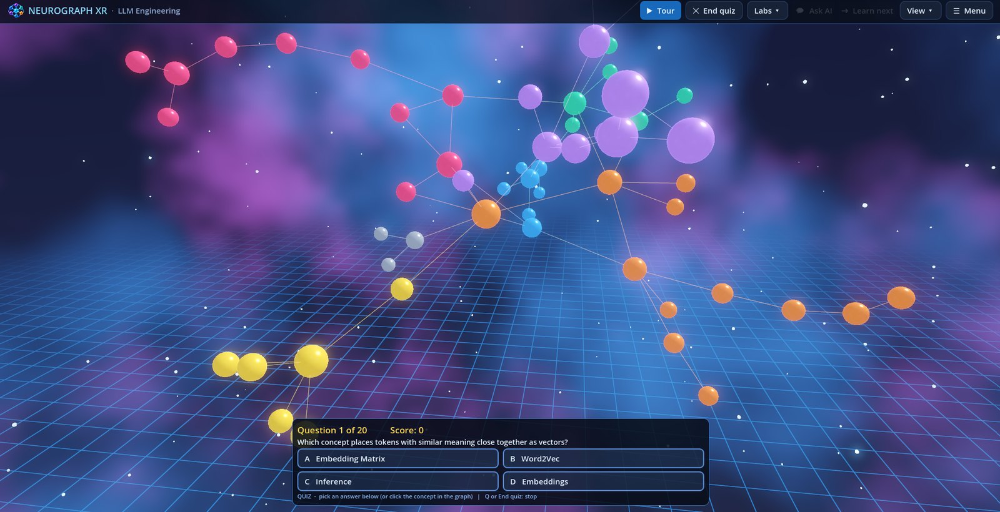</td>
<td>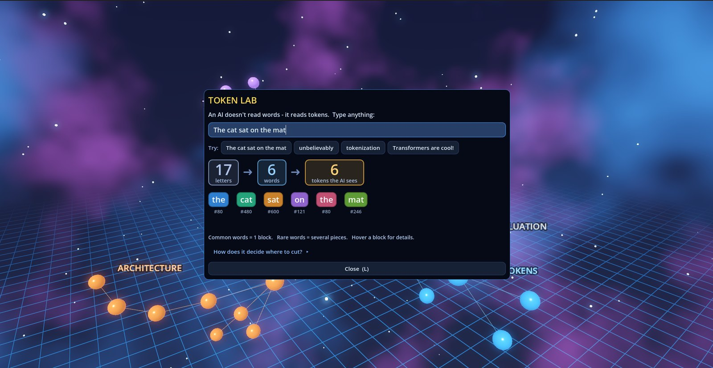</td>
</tr>
<tr>
<td><b>❓ Quiz in the graph</b><br/>Four options per question; the answer lights up in 3D with an explanation, an example and its linked concepts. Missed ones go on your review list.</td>
<td><b>🔤 Token Lab</b><br/>Type anything and watch a <b>real Byte-Pair-Encoding tokenizer</b> (trained on the course text) split it into tokens and token IDs.</td>
</tr>
<tr>
<td>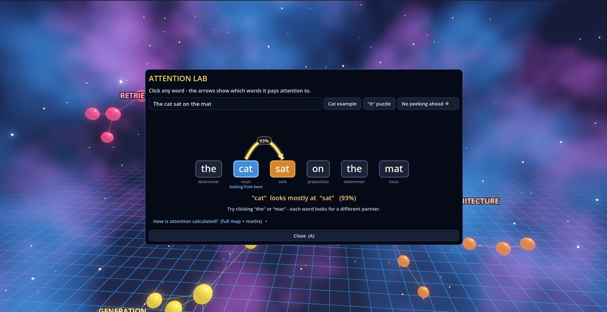</td>
<td>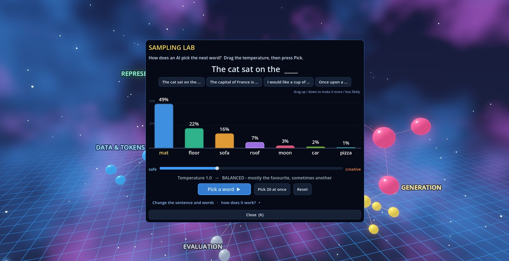</td>
</tr>
<tr>
<td><b>👁️ Attention Lab</b><br/>Click a word to see which words it attends to — scaled dot-product attention on your own sentence, including the famous <i>"it"</i> puzzle and causal masking.</td>
<td><b>🎲 Sampling Lab</b><br/>Drag <b>temperature</b> and <b>top-k</b>, then spin the wheel to see how a model actually picks its next word.</td>
</tr>
</table>

<details>
<summary><b>🎬 And more — click to expand</b></summary>
<br/>

| | |
|---|---|
| 🎞️ **Cinematic intro** | Animated 3D title sequence with music, the same in VR |
| 🗣️ **Narrated guided tour** | A natural neural voice explains the course; concepts *pop* exactly when their names are spoken |
| 📈 **Graph algorithms, visualised** | Hop-by-hop message passing, PageRank iterations and BFS shortest paths animated on the graph |
| 🌡️ **Live calculations** | Softmax at different temperatures, real neuron equations (`z = Σ w·x + b`) |
| 🏷️ **Category filter** | Isolate *Training*, *Retrieval*, *Generation* … clusters |
| 📸 **Screenshots** | Press `P` to save the current view |
| 🧩 **Bring your own course** | All content is plain JSON in `data/` — add concepts, edges, quiz questions and a story without touching code |
| 🎓 **Whole curriculum included** | 7 chapters, 43 lessons, 277 narrated cards, 234 quiz questions and 15 labs, all in the app's own words |
| 🧪 **Eleven extra labs** | Embeddings, bigrams, position encoding, KV cache, MoE, precision, scaling, retrieval, HNSW, pass@k and prompting |

</details>

---

## 🎓 The full AI Engineering course

Press **`U`** (or the **🎓 Course** button, or the *AI COURSE* tile on the home screen) and the app becomes
a complete, self-contained course — the whole AI-engineering curriculum, rewritten in the app's own words.

| | |
|---|---|
| **7 chapters** | Introduction & AI Engineering · From Text to Tokens and Back · Foundations of LLMs · Training & Alignment · Inference & Evaluation · Prompt Engineering · Retrieval-Augmented Generation |
| **43 lessons** | Each with a goal, **277 illustrated concept cards** (text, key points, formulas, worked examples) and **spoken narration** for every card |
| **234 quiz questions** | Four options each, with the explanation of *why* the answer is right — and a spoken explanation |
| **15 hands-on labs** | Every lesson links straight into the lab that belongs to it |
| **Progress tracking** | Lessons finished, cards read and best quiz score are saved; finished lessons get a ✓ |

Chapters and lessons are plain JSON in `data/aie_course.json` and `data/aie_graph.json` — the same
bring-your-own-course format used by the other two courses, so you can extend or translate it without touching code.

<table>
<tr>
<td width="33%">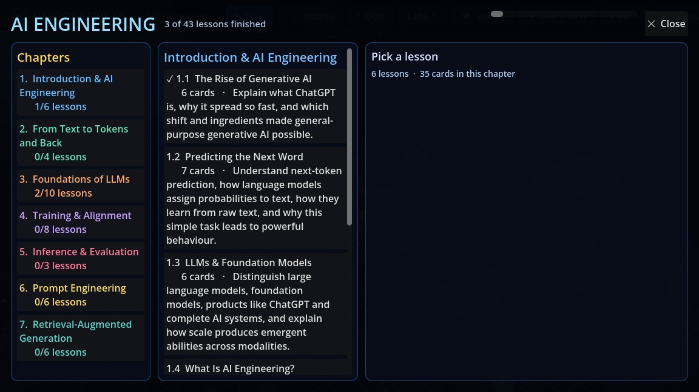</td>
<td width="33%">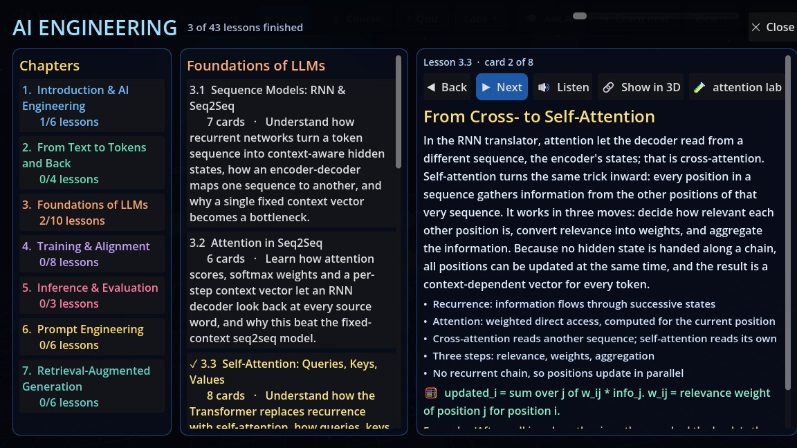</td>
<td width="33%">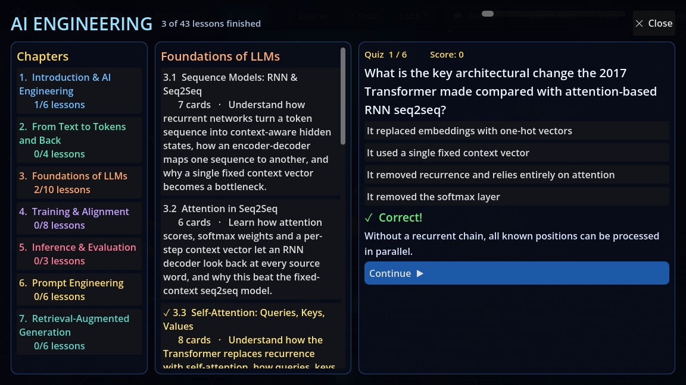</td>
</tr>
<tr>
<td><b>Chapter map</b><br/>Seven chapters, 43 lessons, progress at a glance. Each lesson shows its card count, its goal and whether you finished it.</td>
<td><b>Lesson player</b><br/>Read the card, press <b>🔊 Listen</b> for the natural voice, open the matching lab, or jump to the concept in the 3D graph.</td>
<td><b>Lesson quiz</b><br/>Four choices per question, an explanation after every answer, and a score that is remembered per lesson.</td>
</tr>
</table>

### 🧪 The labs

Three labs were there from the start (**Token**, **Attention**, **Sampling**). The course adds eleven more,
each a small interactive model of one idea:

| Lab | What you can do |
|---|---|
| **Embedding Lab** | Click words in a 2D embedding space, see cosine nearest neighbours, and run `king − man + woman` |
| **Bigram Lab** | Count letter pairs in a real corpus, sample the greedy continuation, and watch it get stuck in a loop |
| **Position Encoding Lab** | The sinusoid table as a heat map, plus the similarity-versus-distance curve that makes positions readable |
| **KV Cache Lab** | Compare prefill vs decode compute, and the cache memory and memory-bandwidth time for any context length |
| **Mixture of Experts Lab** | A router picking top-1 / top-2 / top-4 experts: active parameters stay flat while total parameters grow |
| **Numerics & Precision Lab** | Bit layouts of FP32/TF32/FP16/BF16/FP8/INT8/NF4, model size per format, and a live rounding demo |
| **Scaling Lab** | The Chinchilla trade-off on a log-loss curve — drag the compute budget and see the optimal parameters/tokens split |
| **Retrieval Lab** | One query ranked by BM25, by embeddings, and fused with reciprocal rank fusion |
| **HNSW Lab** | Walk a layered proximity graph greedily, count comparisons against brute force, and tune the search width |
| **pass@k Lab** | pass@k = 1 − (1 − p)^k against pass^k = p^k — why "solved once" and "solved every time" differ |
| **Prompt Lab** | Build a prompt from role / context / format / examples / constraints and watch specificity change |

---

## 🥽 Made for VR — the same app, in your headset

Put on a headset and NeuroGraph XR becomes a room-scale experience. The **complete desktop interface** — intro,
home menu, tour captions, quiz, labs and Ask AI — floats in front of you on a see-through screen, with the
3D graph behind it. Your controller laser is the mouse.

Tested on a **VR headset via SteamVR**. Any **OpenXR-compatible headset** should work — PC VR headsets directly, standalone headsets when streamed to the PC.

### 🎮 VR controls

| Control | Action |
|---|---|
| **Right trigger** | Click buttons / select a concept (laser pointer) |
| **Hold right joystick** | 🎙️ Ask the AI by voice — release to send |
| **Right stick** (pointing at the screen) | Scroll answers and menus |
| **Right stick** (pointing at the graph) | Turn and zoom the model |
| **Left stick** | Move the model (hold **left grip** for forward / back) |
| **Left stick press / Menu** | Start / stop the guided tour |
| **A / B** | Explode layers / switch graph ↔ network |
| **Left X / Left Y** | Explain the selected concept / re-center everything in front of you |
| **Right grip** | Switch course |

<details>
<summary><b>⌨️ Desktop keyboard shortcuts</b></summary>
<br/>

| Key | Action | Key | Action |
|---|---|---|---|
| `1` / `2` | Graph / neural network | `D` | Guided tour |
| `Q` | Quiz | `L` `A` `K` | Token / Attention / Sampling lab |
| `E` | Explode layers | `F` | Forward-pass animation |
| `C` | Switch course | `H` | Home menu |
| `U` | 🎓 AI Engineering course | `←` `→` / `Space` | Previous / next card in a lesson |
| `Space` | Next tour step / next question | `Esc` | Stop the tour |
| `M` / `V` | Music / narration on-off | `P` | Screenshot |
| Mouse | Drag = orbit · wheel = zoom · click = select · Ctrl+click = shortest path | | |

</details>

---

## 🧠 How the AI tutor works (GraphRAG)

A plain LLM can *hallucinate*. NeuroGraph XR first **retrieves the relevant facts from the knowledge graph**,
lights them up in 3D, and tells the model to answer **only** from those facts.

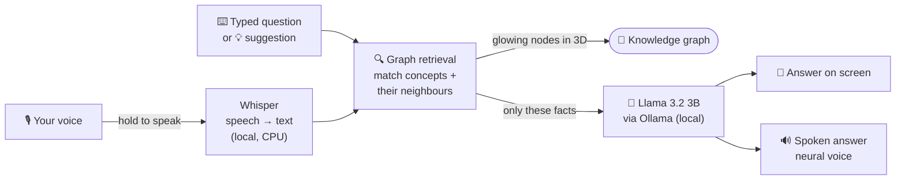

| Stage | Technology | Runs |
|---|---|---|
| Speech → text | [faster-whisper](https://github.com/SYSTRAN/faster-whisper) `base.en`, primed with the course glossary | Local CPU · ~0.8 s |
| Retrieval | Keyword + stemming match on concept names / descriptions, expanded with graph neighbours | In the app |
| Answer | `llama3.2:3b` through [Ollama](https://ollama.com) | Local GPU/CPU · ~2–3 s |
| Text → speech | Microsoft Edge neural voice (`en-US-AvaNeural`), Windows voice as offline fallback | streamed sentence by sentence |

---

## 🚀 Quick start

> **Just want to try it?** &nbsp;[▶ Play in your browser](https://ayush009.github.io/NeuroGraph-XR/) &nbsp;or&nbsp; [⬇ download the Windows app](https://github.com/ayush009/NeuroGraph-XR/releases/latest) (unzip → double-click `NeuroGraph_XR.exe`).
> The steps below are for running it from source.

### 1 · Run the app
1. Install **[Godot 4.7](https://godotengine.org/download)** (standard or .NET build).
2. Clone and open the project:
   ```bash
   git clone https://github.com/ayush009/NeuroGraph-XR.git
   ```
   In Godot: **Import → select `project.godot` → Run (F5)**.

That's it — the 3D graph, tour, quiz and labs all work out of the box. Without a headset it runs in desktop mode.

### 2 · Turn on the AI tutor *(optional)*
```bash
# install Ollama from https://ollama.com, then:
ollama pull llama3.2:3b
```

### 3 · Turn on voice questions *(optional)*
```bash
pip install faster-whisper edge-tts
```
The speech engine (`tools/stt_server.py`) starts and stops automatically with the app. The ~150 MB Whisper model downloads on first use.

### 4 · Play in VR *(optional)*
Connect an OpenXR headset, make **SteamVR** your OpenXR runtime, start SteamVR, then press **F5**.

<details>
<summary><b>🛠️ Troubleshooting</b></summary>
<br/>

| Symptom | Fix |
|---|---|
| *"Ollama is not reachable"* | Start Ollama and run `ollama pull llama3.2:3b` |
| *"The speech engine is not running yet"* | `pip install faster-whisper`, wait ~10 s after start-up |
| *"I didn't catch that"* | Speak closer to the microphone; background talk is filtered out on purpose |
| Answers use a robotic voice | No internet — the neural voice falls back to the Windows voice |
| Starts in desktop mode with a headset on | Wake the headset, check SteamVR is the active OpenXR runtime |

</details>

---

## 🧱 Tech stack & project structure

**Godot 4.7** (GDScript, Forward+, Jolt physics) · **OpenXR** · **Ollama / Llama 3.2** · **faster-whisper** · **edge-tts** · Python

```
NeuroGraph-XR/
├── ds_main.tscn            # main scene
├── scripts/
│   ├── ds_viewer.gd        # the app: graph, network, tour, quiz, labs, VR, AI, voice
│   ├── intro.gd            # cinematic intro
│   ├── token_view.gd       # Token Lab visual
│   ├── attention_view.gd   # Attention Lab visual
│   └── sampling_view.gd    # Sampling Lab visual
├── data/                   # courses as JSON: graph, network, quiz, tokenizer
├── assets/                 # art, music, pre-recorded narration
├── tools/
│   ├── stt_server.py       # local speech-to-text + text-to-speech server
│   └── make_narration.py   # generates the tour narration
└── tests/                  # test scenes (VR probe, voice pipeline, UI preview)
```

<details>
<summary><b>📚 Add your own course</b></summary>
<br/>

Each course is three JSON files listed in `COURSES` at the top of `scripts/ds_viewer.gd`:

| File | Contains |
|---|---|
| `*_graph.json` | `nodes` (id, label, category, desc), `edges` `[from, to, relation]`, `categories` (colours), optional `demo.story` for the guided tour |
| `*_network.json` | `layers` (name, units, shape, params, colour, desc) and output `classes` |
| `*_quiz.json` | `questions` (q, answer = node id, why, example) |

Run the tour once with `N` to record new narration lines, then `python tools/make_narration.py` to voice them.

</details>

---

<div align="center">

### 👤 Author

**Ayush Juyal** &nbsp;·&nbsp; [GitHub @ayush009](https://github.com/ayush009)

If this project helped you understand AI a little better, please consider giving it a ⭐

<sub>Released under the <a href="LICENSE">MIT License</a></sub>

</div>
